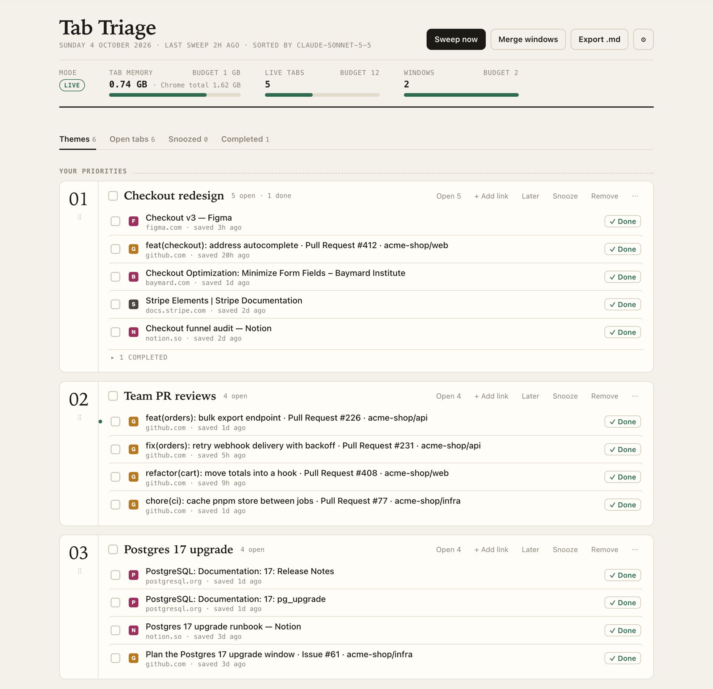
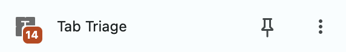
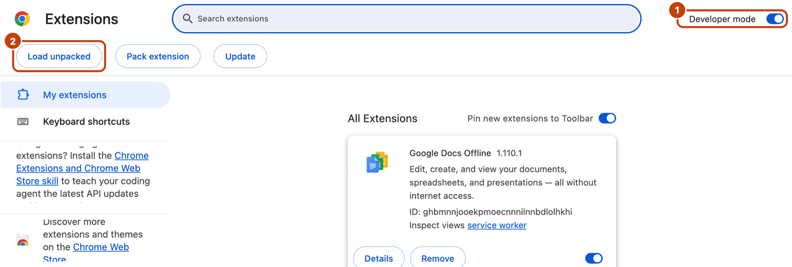
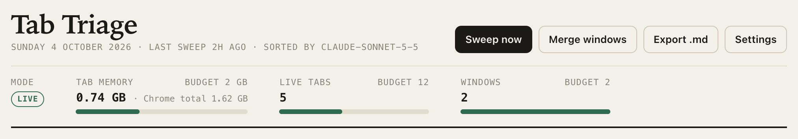
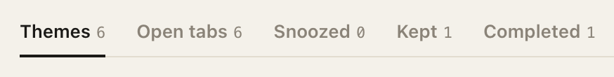

# Tab Triage

If you keep dozens of tabs open because each one is a task you don't want to forget, Tab Triage
takes them off Chrome's hands. Once a day it saves the tabs you haven't touched for a while (4 days by default) into a
dashboard, sorts them into themes (one theme per task or project), and closes them. You work
from the dashboard: prioritize themes, open the tabs for one task, mark them done as you finish.

The result is a couple of Chrome windows with a handful of live tabs, a task list that doesn't
depend on tabs staying open, and far less memory use.

<picture>
  <source media="(prefers-color-scheme: dark)" srcset="docs/images/dashboard-dark.png">
  
</picture>

*The dashboard, shown with demo data.*

Sorting is done by Claude, through the Claude Code CLI. By design it runs **only on a claude.ai
subscription**. An Anthropic API key is never used: if the CLI isn't logged in with a
subscription, or reports an API key, the sorting call is refused instead of being billed to a key
(see [Privacy](#privacy-what-is-sent-to-claude)).

- [What you need](#what-you-need)
- [Install](#install)
- [First run](#first-run)
- [How it runs day to day](#how-it-runs-day-to-day)
- [Using the dashboard](#using-the-dashboard)
- [What gets closed, kept and dropped](#what-gets-closed-kept-and-dropped)
- [Memory guard](#memory-guard)
- [Privacy: what is sent to Claude](#privacy-what-is-sent-to-claude)
- [Settings](#settings)
- [Troubleshooting](#troubleshooting)
- [Updating and uninstalling](#updating-and-uninstalling)
- [How it's built](#how-its-built)
- [License](#license)

## What you need

- **macOS** and **Google Chrome**. The server runs as a macOS login job; other systems aren't
  supported. Other browsers are untested: Chromium-based ones (Edge, Brave, Opera, Arc) can load
  the extension but the memory reading only looks at Chrome's processes, and Firefox and Safari
  would need a port.
- **[uv](https://docs.astral.sh/uv/)**, which runs the server (it fetches Python 3.12+ itself).
- **[Claude Code](https://claude.com/claude-code)** installed at `~/.local/bin/claude` and logged
  in with a claude.ai subscription. Check with `claude auth status`: it should say
  `"authMethod": "claude.ai"`.
- Node.js is only needed to run the extension's tests.

## Install

1. Clone the repo and start the server:

   ```bash
   git clone https://github.com/geopapa11/tab-triage.git
   cd tab-triage
   scripts/install.sh
   ```

   This installs a login job (`local.tab-triage`) that starts the server each time you log in to
   your Mac (after a restart, or after logging out and back in) and restarts it if it stops. It prints `Tab Triage server running on http://127.0.0.1:8765` and
   `claude login ok` when it works.

2. Load the extension in Chrome:
   1. Type `chrome://extensions` in the address bar and press Enter.
   2. Turn on **Developer mode**, the switch at the top right (① in the picture).
   3. Click **Load unpacked**, which appears at the top left once Developer mode is on (②), and
      pick the repo's `extension/` folder. In the file dialog, ⌘⇧G lets you paste the path.
   4. If the Tab Triage icon isn't in Chrome's toolbar, click the puzzle-piece icon at the right
      of the address bar and click the pin next to **Tab Triage**. (If **Pin new extensions to
      Toolbar** is switched on, further down the same page, the icon appears by itself.)

      

   <picture>
     <source media="(prefers-color-scheme: dark)" srcset="docs/images/install-extensions-dark.png">
     
   </picture>

3. Click the Tab Triage icon. The dashboard opens.

Keep Developer mode on; Chrome disables unpacked extensions without it.

## First run

Nothing closes until you approve.

1. Click **Run first sweep**. Every tab that isn't protected (see
   [below](#what-gets-closed-kept-and-dropped)) is saved, whatever its age, and Claude sorts them
   into themes. About 40 tabs take 20 seconds; a few hundred take a couple of minutes. Chrome tab
   groups become themes with the same names.
2. Look the themes over. Drag tabs between themes, rename or merge themes, and drag the ones that
   matter most into **Your priorities**.
3. Click **Approve & close**. The saved tabs close, along with duplicates and junk. Protected
   tabs, and any tab you used after the sweep, stay open.
4. Click **Merge windows** if you're left with several nearly empty windows.

After you approve, a **7-day dry-run** starts: the daily sweep saves stale tabs to the dashboard
but leaves them open, and offers **Close them now**. From day 8 the sweep closes them itself. The
dashboard warns you the day before.

## How it runs day to day

You don't start anything.

| | |
|---|---|
| **Every day at 19:00** | The daily sweep runs. It saves and sorts every tab you haven't used for 96 hours; once the dry-run week is over, it also closes them. 19:00 and 96 hours are the defaults, and you can change both in [Settings](#settings). The time is your Mac's local time, and follows you when you change time zone. |
| **Laptop asleep at 19:00** | The sweep runs when it wakes. |
| **Chrome closed or laptop off at 19:00** | The sweep runs when you next open Chrome, if none ran in the last 24 hours. |
| **After a restart** | Nothing to do. A sweep needs both parts running, and both start by themselves: the server when you log in to your Mac, the extension when Chrome opens. If the server is down, the dashboard says "Can't reach the local server" and no tab is closed. |
| **Any time** | **Sweep now** runs a sweep immediately and **ignores how recently you used a tab** (the *A tab is stale after* setting): every tab that isn't protected is saved and, once the dry-run week is over, closed. It shows a count and asks first. |

The sweep only runs while Chrome is open.

## Using the dashboard

Open it with the toolbar icon. Pin the dashboard tab if you want it always there; pinned tabs
are never swept.

**The header** shows the mode (First run / Dry-run / Live), tab memory against its budget, how
many tabs are loaded, and how many windows are open.

<picture>
  <source media="(prefers-color-scheme: dark)" srcset="docs/images/header-dark.png">
  
</picture>

The dashboard has five views: **Themes** (your list, in priority order, with unranked themes
below and Later ones at the bottom), **Open tabs** (every web page open in Chrome right now,
except the dashboard itself and Chrome's own pages such as `chrome://extensions`), **Snoozed**,
**Kept** (every tab you chose to keep, by theme, including themes that have left the list) and
**Completed**.

<picture>
  <source media="(prefers-color-scheme: dark)" srcset="docs/images/views-dark.png">
  
</picture>

### What you can do

Each row is one thing you might want to do, and how to do it. Names in bold are the buttons and
labels as they appear on the dashboard.

| To do this | Do this |
|---|---|
| Open a saved tab | Click its title. Nothing else on the row opens it: the checkbox selects, and the rest of the row is for dragging. |
| Work on a theme | **Open N** opens its top tabs (6 by default) in a new window. |
| Remove a tab you no longer need | Hover over it and click **Remove**. It leaves the list without going to **Completed**, and closes in Chrome if it's open there. **Undo** in the message that appears brings it back. |
| Add a tab that's open in Chrome | **Open tabs** view → **Add & close** or **Add, keep open** on its row → pick a theme, **Let Claude choose**, **On its own** (Unsorted) or **New theme…**. The row shows if the page is already saved. |
| Add the tab you're on, without the dashboard | Right-click **inside the page** → **Add this tab to Tab Triage** → **Add & close** or **Add, keep open** → a theme, **Let Claude choose**, or **On its own (Unsorted)**. It also works by right-clicking the Tab Triage toolbar icon. Chrome doesn't allow extensions in the menu you get by right-clicking a tab in the tab bar at the top of the window. |
| Add a tab from a link | **+ Add tab**, at the top of a theme card or under its last tab. Paste the link and press Enter. The title is filled in. |
| Mark a tab done | Click **✓ Done** on its row. It greys out, drops to the bottom of the theme and appears under **Completed** for 60 days (by default), then is deleted for good. **Restore** brings it back. |
| Keep a tab you've finished but want to read again | Hover over it and click **Keep** (also offered on rows in **Completed**). It moves to a **Kept** group at the bottom of its theme and is never deleted. It no longer counts as open work: **Open N**, **Mark all done** and the checkboxes skip it. **Stop keeping** moves it to Completed. |
| Prioritize themes | Drag a theme by its number. While you drag, cards collapse to headers and a "Drop here to make it #1" bar appears at the top. Or use **⋯ → Move to top / Move up / Move down**. |
| Reorder or move tabs | Drag a tab within its theme, onto another theme, or onto a theme in **Later**. **Move to…** in the selection bar lists every theme, including Later and snoozed ones. |
| Act on several tabs | Tick their checkboxes (shift-click for a range), or tick the box next to a theme's name to select all its tabs. A bar appears just above the topmost selected tab with **Done**, **Move to…**, **Snooze** and **Remove**. Esc clears. |
| Hide something until a date | **Snooze** a tab or a theme (tomorrow, next Monday, in a week, or a date). It returns marked "Back". |
| Put a theme aside with no date | **Later** collapses it to one line at the bottom. Click the line to bring it back to its place. |
| Rename a theme | Click its name. |
| Combine themes | **⋯ → Merge into…**, then pick the theme from the searchable list. |
| Finish a whole theme | **⋯ → Mark all done**. Reversible while the tabs are in Completed. |
| Undo a grouping you don't like | **⋯ → Dissolve**. Its tabs go back to Claude to be re-sorted, and Claude is told not to recreate that theme. |
| Remove a theme | **Remove** on the theme card, or **⋯ → Remove theme**. All its tabs leave the list (and close in Chrome if open); tabs you had already completed keep their history in Completed, and kept tabs stay in the Kept view. **Undo** in the message brings everything back. |
| Reduce the number of windows | **Merge windows** brings you down to two windows: the dashboard's window and one other (the one with your inboxes, else the largest) stay as they are, and tabs from every other window move into them. With two or fewer windows it does nothing. Nothing is closed. |
| Keep a copy | **Export .md** downloads the list as Markdown. |

A theme you haven't touched for 14 days (by default) shows **Stale — drop it?**. Touching a theme
means adding, opening, completing or snoozing one of its tabs. The label is only a suggestion:
nothing changes unless you click it. Clicking it asks first, then marks all the theme's tabs done:
the theme leaves the list and its tabs wait in Completed, where **Restore** brings any of them
back. To clear the label without dropping the theme, use it: open, add, complete or snooze one of
its tabs. When Claude thinks two themes overlap, the card shows a **Merge** suggestion you can accept
or dismiss.

**Done, Keep or Remove:**

- **✓ Done** when you've finished with a tab. It stays in Completed (60 days by default) as a
  record, then is deleted.
- **Keep** when you've finished with it but will want to read it again. It stays with its theme
  and is never deleted.
- **Remove** when it turned out not to be useful. It leaves no history.

Your corrections (moving a tab to another theme, renaming, merging, dissolving) are passed to
Claude on later sweeps so it stops repeating the same mistake.

## What gets closed, kept and dropped

A tab is **stale** when you haven't looked at it for 96 hours (the default; it's a setting). The automatic 19:00 sweep only
takes stale tabs; **Sweep now** and the first run take every tab that isn't protected.

**Never closed:**
- pinned tabs
- the tab you're on in each window
- tabs playing audio
- tabs with a half-filled form or a chosen upload (if the check can't run on a page, the tab is
  left open)
- the keep-open list: Gmail inbox, Google Calendar and Linear by default (one copy of each;
  extra copies count as duplicates)
- any tab you used after it was saved

**Saved to the dashboard, then closed:** every other stale tab. Gmail threads go to an
"Email follow-ups" theme by subject line only. A kept tab that you opened again is closed the
same way and stays kept; a completed one becomes open work again.

**Closed without saving:**
- exact duplicates of another open tab, at any age (the most recently used copy stays)
- and, once stale (or at any age in the first run):
  - Google, Bing and DuckDuckGo search results, and Gmail searches
  - Google Meet pages
  - sign-in pages
  - `chrome://` and other internal pages

Right before closing anything, the extension re-reads your tabs: a tab that navigated elsewhere
or was touched since the sweep started stays open.

**Themes:** Claude reuses an existing theme when one fits and creates a new one only when at
least 2 tabs (by default) belong to it. Leftovers go to **Unsorted**, which is always listed last; its **Re-sort**
button asks Claude to try those tabs again. New themes stop being created at the maximum set in
Settings.

## Memory guard

Every 5 minutes (by default), and after a page finishes loading, the extension checks how much memory Chrome's
tabs use. Above the **tab memory budget** (2 GB by default) it *unloads* the two least recently
used tabs, and repeats until it is under. An unloaded tab is not closed. It is in the
state every tab is in right after you restart Chrome: still there in the row of tabs at the top
of the window, with its title and icon, but the page itself isn't loaded and uses no memory.
When you click the tab, the page loads again, as it does after a restart. The tab you're on, any tab you used in the last 24 hours (by default), tabs playing audio
and tabs with half-filled forms are never unloaded; keep-open and pinned tabs go last.

The header also shows Chrome's total. That figure includes Chrome itself, the GPU process and
extensions, which unloading tabs can't reduce, and it over-counts memory that Chrome's processes
share, so it reads higher than Chrome's own Task Manager.

## Privacy: what is sent to Claude

Everything is stored locally in `~/Library/Application Support/tab-triage/tabs.db`. The only
thing that leaves your machine is the sorting request to Claude, through the `claude` CLI:

- each swept tab's **title**, **URL** and Chrome tab-group name
- up to **1,500 characters of page text** (the default; the limit is a setting, at most 2,000), only for tabs that are loaded at sweep time
- your existing theme names with a few sample titles, and your recent corrections

Page text is **never read** on the never-read list (Gmail, Google Drive and Docs, AWS, LinkedIn
messaging, PayPal, Revolut, anything with "bank" in the address, by default) or on sign-in
pages. For those, only the title and URL are sent. You can add to or shorten the list under
**Never read page text** in [Settings](#settings).

**Subscription only.** Before each sorting call the server checks that `claude` is logged in with
claude.ai, runs it with no `ANTHROPIC_*` environment variables and without your Claude Code
settings, and kills the call if it reports any API-key source. If the login is wrong, nothing is
sent and the dashboard says so.

The server listens on `127.0.0.1` only and refuses requests from web pages.

## Settings

The **Settings** button at the top right of the dashboard. Each field has a short explanation and its allowed range; a value
outside the range is flagged under the field and not saved. **Save** keeps the panel open; click
outside it (or **Close**) to leave, and it asks first if you have unsaved changes. The numbers used elsewhere in this README (96 hours, 19:00,
60 days, and so on) are these defaults.

| Setting | Default | Range | What it does |
|---|---|---|---|
| A tab is stale after | 96 hours | 1–720 | The daily sweep saves tabs untouched for this long. **Sweep now** ignores it. |
| Daily sweep time | 19:00 | any time | When the automatic sweep runs. |
| Keep completed tabs for | 60 days | 1–365 | How long a tab you marked done stays in Completed. After that it is deleted for good, from the database too. |
| "Open N" opens at most | 6 tabs | 1–12 | How many of a theme's top tabs open at once. |
| Snoozed items wake at | 08:00 | any time | Time of day a snoozed tab or theme comes back. |
| Sorting model | `sonnet` | | A Claude Code model alias, so it follows new versions. Falls back to `haiku` if unavailable. |
| Maximum themes | 15 | 5–60 | Claude stops creating themes at this count. Raise it if you have many Chrome tab groups: each becomes a theme and counts. |
| Tab memory budget | 2048 MB | 256 and up | Above this, Chrome frees the memory of tabs you haven't used recently. They stay open in Chrome's tab bar and reload when clicked; nothing is closed. |
| Keep tabs in memory if used in the last | 24 hours | 0–168 | Tabs used more recently than this are never freed from memory, so they don't reload when you return. |
| Keep open | Gmail inbox, Calendar, Linear | | URL patterns never closed. One per line; `*` matches anything. |
| Never read page text | see [Privacy](#privacy-what-is-sent-to-claude) | | URL patterns whose page text is never sent. |

Under **Advanced**:

| Setting | Default | Range | What it does |
|---|---|---|---|
| Flag a theme as stale after | 14 days | 1–90 | When "Stale — drop it?" appears on a theme you haven't touched. It is only a label: nothing is deleted or changed unless you click it. |
| Check memory every | 5 minutes | 1–60 | How often tab memory is measured (also after each page load). |
| A new theme needs at least | 2 tabs | 1–10 | Fewer than this go to Unsorted instead of starting a theme. |
| Page text sent to Claude | 1,500 characters | 0–2,000 | Per tab. 0 sends titles and addresses only. |
| Tabs per Claude call | 40 | 5–50 | Batch size for sorting. |

Fixed in code:

- the dry-run lasts 7 days
- a memory check never runs twice within 30 seconds. A check is started by the timer and also by
  every page that finishes loading. If you open ten links at once, the first page starts a check
  and the other nine are skipped, because a check has just run
- each check unloads at most two tabs
- a removed tab can be brought back with Undo for 1 day

## Troubleshooting

| You see | Do this |
|---|---|
| **"Can't reach the local server"** | Run `scripts/install.sh` again. Check `~/Library/Logs/tab-triage.log`. |
| **"Sorting failed … Claude isn't logged in"** | Run `claude auth login`, then click **Re-sort**. The tabs were saved to Unsorted; nothing is lost. |
| Most tabs land in **Unsorted** | Raise **Maximum themes** in Settings, then click **Re-sort** on the Unsorted card. |
| The dashboard looks out of date after an update | Click reload (↻) on the Tab Triage card in `chrome://extensions`, then refresh the dashboard. |
| The 19:00 sweep saved 0 tabs | Normal: nothing has been untouched for 96 hours yet. Use **Sweep now** to clear everything unprotected anyway. |
| Chrome's total memory stays high | Quit and reopen Chrome, and check Chrome's Task Manager (⋮ → More tools) for heavy tabs and extensions. |
| Tab Triage disappeared from Chrome | Developer mode was turned off. Turn it on and load the `extension/` folder again; your saved tabs are still in the database. |

If the extension itself seems to misbehave (a sweep didn't run, tabs weren't closed), look at its
error log: open `chrome://extensions`, find the Tab Triage card, and click the blue **service
worker** link next to "Inspect views". Chrome's developer tools open; the **Console** tab lists
any error from the extension, marked `[tab-triage]`. An empty console means no errors.

## Updating and uninstalling

**Update:**

```bash
git pull
launchctl kickstart -k gui/$(id -u)/local.tab-triage
```

Then click reload (↻) on the Tab Triage card in `chrome://extensions` and refresh the dashboard.

**Uninstall:** run `scripts/uninstall.sh` and remove the extension in `chrome://extensions`. Your
saved tabs stay in `~/Library/Application Support/tab-triage/`; delete that folder to remove them.

## How it's built

- **`extension/`** — a Chrome extension (Manifest V3). It decides which tabs are stale, reads
  page text, closes and unloads tabs, and hosts the dashboard. The decision logic is in
  `extension/lib/` as plain functions.
- **`server/`** — a local server on `127.0.0.1:8765` using only Python's standard library and
  SQLite. It stores everything, runs `claude -p` to sort, and measures Chrome's memory. About
  15 MB of RAM.

How the parts work together and the API are described in
[docs/ARCHITECTURE.md](docs/ARCHITECTURE.md); the database tables and columns are in
[docs/DATABASE.md](docs/DATABASE.md).

**Tests:**

```bash
uv run pytest
node --test 'extension/**/*.test.js'
```

## License

MIT. See [LICENSE](LICENSE).
