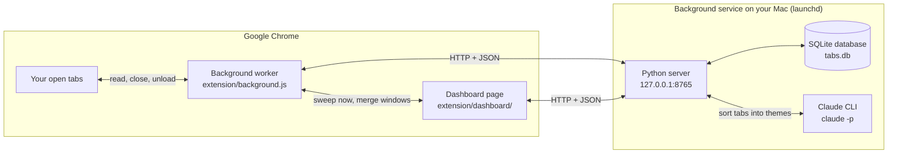
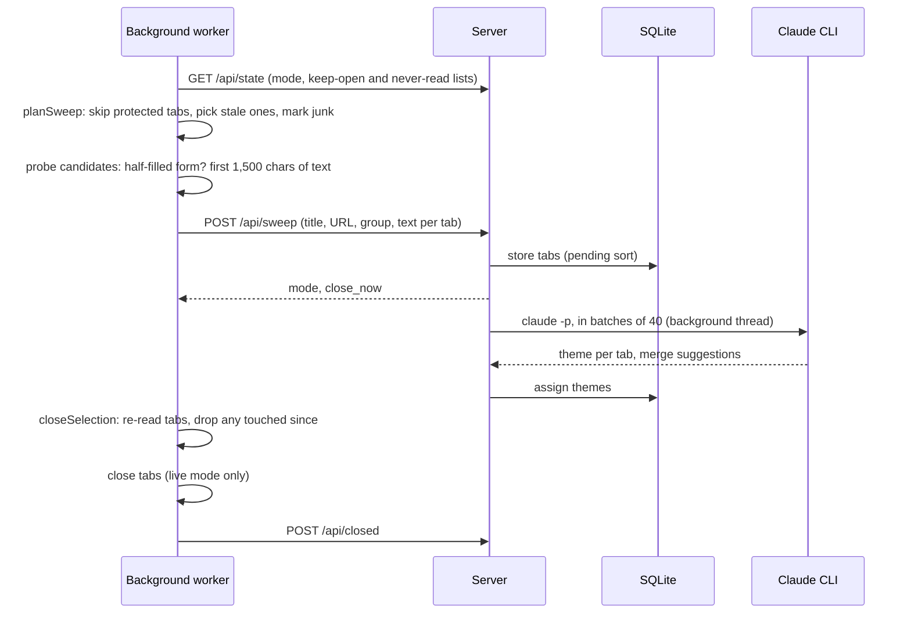

# Architecture

How Tab Triage works, for someone reading the code. For how to use it, see the
[README](../README.md). For why it was designed this way, see [PLAN.md](PLAN.md).

## The three parts



| Part | Code | Runs in | Responsible for |
|---|---|---|---|
| **Background worker** | `extension/background.js` | Chrome (Manifest V3 service worker) | Everything that touches Chrome: reading tabs, deciding what is stale, reading page text, closing and unloading tabs, alarms, the right-click menu. |
| **Dashboard** | `extension/dashboard/` | Chrome, as an extension page | The user interface. Reads and writes the list through the server; asks the worker for anything that touches Chrome. |
| **Server** | `server/` | macOS login job | Storage (SQLite), sorting (runs `claude -p`), and measuring Chrome's memory. |

### Why it is split this way

- **Only an extension can see tabs properly.** When a tab was last used, its tab group, whether
  it plays audio, what is typed into its forms — and only an extension can close or unload a tab.
- **Only a local process can run `claude` and read process memory.** An extension can do neither.
- **The dashboard is an extension page, not a web page served by the server**, so it can open,
  close and move tabs directly, and the server stays a plain JSON API.

## Decision logic is kept out of the Chrome wiring

`background.js` and `dashboard/app.js` contain no rules. Every decision is a plain function in
`extension/lib/` with no `chrome.*` calls, so it can be unit-tested with Node:

| File | Decides |
|---|---|
| `lib/rules.js` | Which tabs a sweep saves, drops or leaves (`planSweep`); the final check before closing (`closeSelection`); which tabs the memory guard may unload (`unloadOrder`); what counts as a sign-in page, a Gmail thread, junk; alarm timing. |
| `lib/tidy.js` | Which tabs move where for **Merge windows** (`planTidy`). |
| `lib/addmenu.js` | The right-click menu's items and ids; reading a pasted link's title. |
| `lib/dnd.js` | Drop positions, the new theme order after a drag or a menu move, edge-scroll speed. |
| `lib/select.js` | Shift-click ranges; the theme list for the picker. |
| `lib/time.js` | Snooze presets, "3h ago", day labels, local date stamps. |
| `lib/seen.js`, `lib/api.js` | Small I/O helpers: the "last looked at" record, and the HTTP client. |

The server follows the same idea: `server/store.py` (storage), `server/classifier.py` (sorting),
`server/memory.py` (measurement) and `server/app.py` (HTTP routing) are separate, and the server
is built with its sorter and memory reader passed in, so tests replace them.

## A sweep, step by step

A sweep runs at 19:00 (`chrome.alarms`), when Chrome starts if none ran in 24 hours, or when you
click **Sweep now**.



Points worth knowing:

- **Stored before closed.** The worker only closes tabs after the server has acknowledged them.
- **Modes.** `first-run` (nothing closes until you approve) → `dry-run` for 7 days (sweeps save
  but do not close) → `live`. The mode is computed by the server from one stored date
  (`sweep_mode` in `server/app.py`).
- **Age.** The automatic sweep takes tabs untouched for 96 hours. The first run and **Sweep now**
  ignore age (`ignoreAge`).
- **Re-check before closing.** Reading page text takes time, so tabs are re-read right before
  closing: a tab that navigated elsewhere, was used since the sweep started, or has a
  half-filled form stays open.
- **Sorting is asynchronous.** The dashboard polls every 2.5 seconds while `sorting` is true.

## Sorting with Claude

`server/classifier.py` builds one prompt per batch: the existing themes with sample titles, your
recent corrections, and the tabs. It runs:

```
claude -p --setting-sources "" --model sonnet --fallback-model haiku --tools "" \
  --strict-mcp-config --no-session-persistence --output-format stream-json --verbose \
  --json-schema <schema>
```

The reply is validated and then passed through `apply_rules`, which enforces the theme rules in
code rather than trusting the model: reuse an existing theme when the name matches, a new theme
needs at least 2 tabs, the number of themes is capped, everything else goes to **Unsorted**.

**Subscription-only guard.** Three independent checks, each covered by a test:

1. The child process gets a minimal environment — no `ANTHROPIC_*` variables — and loads no
   Claude Code settings.
2. `claude auth status` must report a `claude.ai` login before any prompt is sent.
3. The call's first event must report `apiKeySource: "none"`; otherwise the process is killed
   before it produces a result.

If any check fails, nothing is sent, the tabs go to Unsorted, and the dashboard shows why.

## The dashboard

`dashboard/app.js` keeps no state of its own beyond what is selected or expanded. Every action
is one API call followed by a full refresh from the server, then a re-render. This is simple and
fast enough for a few hundred tabs.

- **Reads:** `/api/state`, `/api/board`, `/api/completed`, `/api/pending-close`, `/api/memory`,
  every 20 seconds and when the tab becomes visible.
- **Writes:** tick, snooze, move, rename, merge, reorder, remove, add — all go to the server.
- **Chrome actions** go to the worker by message: `sweepNow`, `previewSweep`, `closePending`,
  `tidyWindows`, `themesChanged`.
- **Corrections.** Moving a tab to another theme, renaming, merging and dissolving are recorded
  in the `corrections` table and included in later prompts.

## Adding a page from outside

The worker builds a right-click menu (`chrome.contextMenus`) from the current themes and rebuilds
it when they change. Choosing an item sends the page to `POST /api/tabs/add` with a theme name,
`"Unsorted"`, or no theme (Claude chooses), and optionally closes the tab.

## The memory guard

Every 5 minutes, and after a page finishes loading (at most once per 30 seconds), the worker
asks `GET /api/memory`. The server sums the memory of Chrome's web-page processes with `ps`
(extension, GPU and browser processes are reported separately, since unloading tabs cannot
shrink them). If tab memory is over the budget, the worker unloads (`chrome.tabs.discard`) up
to two tabs, least recently used first.

Never unloaded: the active tab in each window, tabs playing audio, tabs with half-filled forms,
and **any tab used in the last 24 hours**. The worker keeps its own record of when each tab was
last looked at or left (`chrome.storage.session`), because Chrome only records when a tab was
switched *to*.

## Data

### SQLite: `~/Library/Application Support/tab-triage/tabs.db`

| Table | Columns that matter |
|---|---|
| `themes` | `name` (unique), `position` (rank; null = unranked), `suggested_position`, `touched_at` (for the stale badge), `snoozed_until`, `later`, `back` |
| `tabs` | `url` (unique), `title`, `theme_id` (null = waiting to be sorted), `position`, `status` (`open` / `done` / `removed`), `captured_at`, `last_seen_at`, `completed_at`, `removed_at`, `snoozed_until`, `pending_close` (saved but still open in Chrome), `text`, `group_hint` |
| `corrections` | `kind` (`move` / `rename` / `merge` / `dissolve`), `detail` (JSON) |
| `settings` | `key`, `value` (JSON): model, budgets, keep-open and never-read lists, first-run date, last sort error |

Times are Unix seconds. New columns are added in place at startup (`Store._migrate`). Completed
tabs are deleted after 45 days and removed tabs after 1 day (`Store.purge`, run on every sweep
and every 6 hours).

### Chrome extension storage

Not in SQLite, because only the extension needs it:

- `chrome.storage.local`: when each URL was last looked at (survives Chrome restarts, which
  reset Chrome's own value), the last sweep's result, the last memory reading, the last error.
- `chrome.storage.session`: when each tab id was last active, for the memory guard.

## The HTTP API

All JSON, on `127.0.0.1:8765` only.

| Method and path | Purpose |
|---|---|
| `GET /health` | Liveness check. |
| `GET /api/state` | Mode, sorting status, last sort error, merge suggestions, settings. |
| `GET /api/board` | Themes with their tabs; Later and snoozed themes; snoozed tabs. |
| `GET /api/completed` | Completed tabs, newest first. |
| `GET /api/pending-close` | Tabs saved but still open in Chrome (first run and dry-run). |
| `GET /api/memory` | Chrome's total and tab memory, the budget, and whether it is over. |
| `GET /api/export.md` | The list as Markdown. |
| `POST /api/sweep` | Store swept tabs and start sorting. |
| `POST /api/closed` | The worker reports which saved tabs it closed. |
| `POST /api/first-run/complete` | Start the dry-run week. |
| `POST /api/tabs/{id}/{check,uncheck,snooze,move,opened,remove}` | Act on one tab. |
| `POST /api/tabs/bulk` | Check, snooze, move or remove several tabs. |
| `POST /api/tabs/restore` | Undo a remove. |
| `POST /api/tabs/add` | Add a page to a theme, or let Claude choose. |
| `POST /api/themes/reorder` | Set the full ranked order. |
| `POST /api/themes/{id}/{rename,merge,snooze,done,dissolve,later,delete}` | Act on one theme. |
| `POST /api/opened` | Tabs were opened from the dashboard. |
| `POST /api/resort` | Sort the Unsorted tabs again. |
| `POST /api/merge-suggestions/dismiss` | Dismiss a merge suggestion. |
| `PATCH /api/settings` | Change settings (known keys only). |

### Keeping other web pages out

Any web page can try to send requests to `localhost`, so the server checks every request
(`_allowed` in `server/app.py`):

- The `Host` header must be `127.0.0.1` or `localhost` (blocks DNS rebinding).
- A browser `Origin`, when present, must be a `chrome-extension://` origin.
- Writes must carry an `X-Tab-Triage` header. A web page can only add it through a CORS
  preflight, which the server never answers.

## How it stays running

- **Server:** `scripts/install.sh` writes `~/Library/LaunchAgents/local.tab-triage.plist`
  with `RunAtLoad` and `KeepAlive`, so macOS starts it at login and restarts it if it exits. It
  runs `uv run python -m server`. Log: `~/Library/Logs/tab-triage.log`.
- **Worker:** Chrome suspends the service worker when idle and wakes it for alarms, tab events
  and messages. Nothing important is kept in module variables; alarms are only created when
  missing, so waking does not postpone them.

## Tests

```bash
uv run pytest                           # server: storage, API, sorting and its guard
node --test 'extension/**/*.test.js'    # extension decision logic
```

Sorting tests use a scripted stand-in for the `claude` executable (`tests/fake_claude.py`) that
can succeed, return bad output, hang, report the wrong login or an API-key source. The Chrome
wiring and drag-and-drop are not unit-tested; they are checked by hand.
