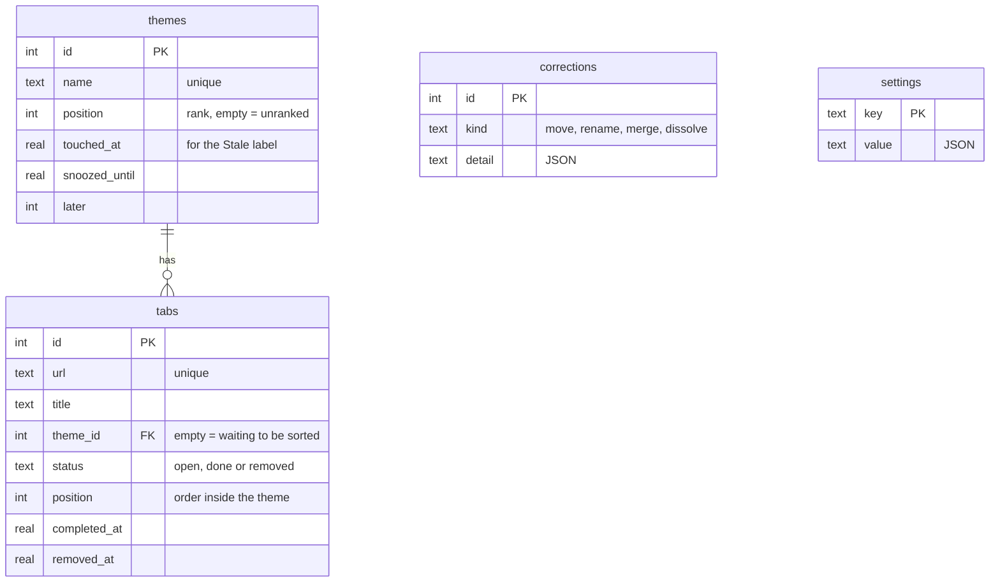
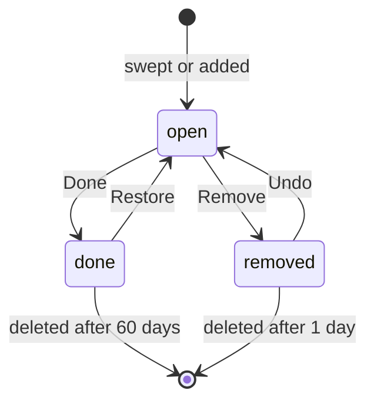

# Database

- Everything Tab Triage remembers is in one SQLite file:
  `~/Library/Application Support/tab-triage/tabs.db`.
- Only the server reads and writes it (`server/store.py`). The extension never touches it.
- There are four tables: `themes`, `tabs`, `corrections` and `settings`.

For how the parts of the system fit together, see [ARCHITECTURE.md](ARCHITECTURE.md).

## How the tables connect



- **One theme has many tabs.** `tabs.theme_id` points at `themes.id`. A tab belongs to at most
  one theme.
- **A tab with no theme** (`theme_id` empty) has been saved but not sorted yet.
- **`corrections` and `settings` stand alone.** They are not linked to a theme or a tab by id;
  a correction stores the names involved at the time.

## `themes`: one row per theme

| Column | Type | Meaning |
|---|---|---|
| `id` | integer | The theme's id. |
| `name` | text, unique | The name shown on the card. "Unsorted" is an ordinary theme with that name. |
| `position` | integer or empty | Your priority: 0 is #1. Empty means unranked. |
| `suggested_position` | integer or empty | The rank Claude suggested for an unranked theme. |
| `created_at` | time | When the theme was created. |
| `touched_at` | time | The last time a tab in it was added, opened, completed or snoozed. Drives the "Stale" label. |
| `snoozed_until` | time or empty | Hidden until this time. |
| `back` | 0 or 1 | 1 when it has just returned from a snooze (shows "Back"). |
| `later` | 0 or 1 | 1 when you parked it in the Later list. |

## `tabs`: one row per saved page

| Column | Type | Meaning |
|---|---|---|
| `id` | integer | The tab's id. |
| `url` | text, unique | The page address. A page is stored once, however many times it is swept. |
| `title` | text | The page title. |
| `theme_id` | integer or empty | The theme it is in. Empty while it waits to be sorted. |
| `position` | integer | Order inside its theme, lowest first. |
| `status` | text | `open` (on your list), `done` (completed) or `removed` (waiting for Undo). |
| `captured_at` | time | When it was first saved. |
| `last_seen_at` | time | The last time a sweep saw it open in Chrome. |
| `last_accessed_at` | time or empty | When you last used it in Chrome, as reported by the extension. |
| `completed_at` | time or empty | When you marked it done. |
| `removed_at` | time or empty | When you removed it. |
| `snoozed_until` | time or empty | Hidden until this time. |
| `back` | 0 or 1 | 1 when it has just returned from a snooze. |
| `pending_close` | 0 or 1 | 1 when it is saved but still open in Chrome (first run and dry-run). |
| `in_chrome` | 0 or 1 | 1 after you opened it from the dashboard, until it is closed again. |
| `text` | text or empty | The page text read for sorting (at most 2,000 characters). Empty for never-read pages and for tabs that weren't loaded when swept. |
| `group_hint` | text or empty | The Chrome tab group it was in, passed to Claude as a hint. |

### The life of a tab row



## `corrections`: what you changed, for Claude

Each time you move a tab to another theme, rename a theme, merge two themes or dissolve one, a
row is added. The most recent ones are included in later sorting requests so the same mistake
isn't repeated.

| Column | Type | Meaning |
|---|---|---|
| `id` | integer | Row id. |
| `kind` | text | `move`, `rename`, `merge` or `dissolve`. |
| `detail` | text (JSON) | The names involved, for example `{"from": "Reading", "to": "Postgres 17 upgrade"}`. |
| `created_at` | time | When it happened. |

## `settings`: one row per stored value

`key` is the name and `value` is JSON. Two kinds of rows live here:

- **Your settings**, but only the ones you have saved. A setting with no row uses the default
  from `server/settings.py`, so changing a default in the code does not change a value you saved.
- **The server's own notes:** `first_run_done_at` (when the dry-run week started), `last_sweep`,
  `last_model`, `sort_error` and `merge_suggestions`.

## When rows are deleted

| What | When |
|---|---|
| A completed tab (`status = done`) | 60 days after `completed_at` (the *Keep completed tabs for* setting). The row is deleted; nothing is archived. |
| A removed tab (`status = removed`) | 1 day after `removed_at`. Until then, Undo sets it back to `open`. |
| A theme | When you merge, dissolve or remove it and no completed tab still belongs to it, or when it has had no tabs at all for a day. |
| A stale theme | Never, by itself. "Stale" is only a label worked out from `touched_at` each time the list is shown. |

The clean-up (`Store.purge`) runs on every sweep and every 6 hours.

## Details

- **Times** are Unix seconds (seconds since 1970), stored as numbers.
- **New columns** are added in place when the server starts (`Store._migrate`); there are no
  separate migration files.

## Looking inside

Any SQLite viewer works, for example DBeaver: create a SQLite connection and pick the file
above. Open it read-only, or only look: the server is using the file at the same time.

From a terminal:

```bash
sqlite3 -readonly "$HOME/Library/Application Support/tab-triage/tabs.db"
```

```sql
-- open tabs per theme, in priority order
SELECT th.name, COUNT(*) AS open_tabs
FROM tabs t JOIN themes th ON th.id = t.theme_id
WHERE t.status = 'open'
GROUP BY th.id
ORDER BY th.position IS NULL, th.position;

-- what was completed this week
SELECT title, datetime(completed_at, 'unixepoch', 'localtime') AS done_at
FROM tabs
WHERE status = 'done' AND completed_at > unixepoch() - 7 * 86400
ORDER BY completed_at DESC;
```
